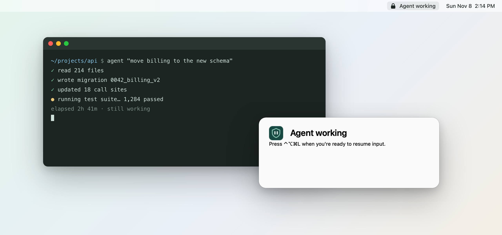
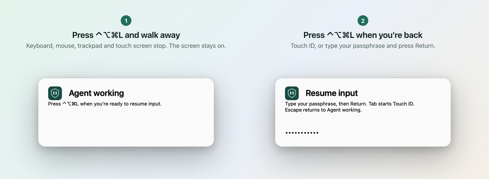
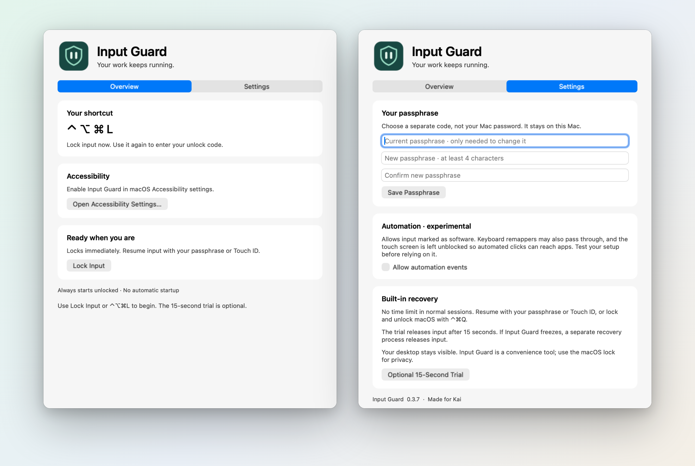

<p align="center">
  
</p>

<h1 align="center">Input Guard</h1>

<p align="center">
  <b>Walk away from your Mac. Your agents keep working.</b><br>
  A small macOS menu-bar app that locks your keyboard, mouse, trackpad and touch screen<br>
  while the screen stays on and everything keeps running.
</p>

<p align="center">
  
  
  
  <a href="LICENSE"></a>
</p>

<picture>
  <source media="(prefers-color-scheme: dark)" srcset="docs/images/hero-dark.png">
  
</picture>

## Why

You start an agent on a long job: a refactor, a test run, a render, a big upload. Then you want to get up.

- **Lock the screen** and screen-driven work stops: anything that clicks, types or watches the screen for you can't see or reach your apps, and you can't glance at progress from across the room.
- **Leave it open** and anyone (a coworker, a kid, a cat on the keyboard) can type into your agent's terminal or click something they shouldn't.

Input Guard is the third option. Press **⌃⌥⌘L** and every key, click, scroll and touch is ignored. The desktop stays visible, the Mac and display stay awake, and your agents, builds and downloads keep going. Press **⌃⌥⌘L** again when you're back and unlock with Touch ID or your passphrase.

<picture>
  <source media="(prefers-color-scheme: dark)" srcset="docs/images/flow-dark.png">
  
</picture>

## Features

- **One shortcut.** ⌃⌥⌘L locks from any app. The same shortcut brings up the unlock prompt; it never unlocks on its own.
- **Blocks everything you touch.** Keyboard, mouse, trackpad, and touch screens (built in, external, or a Sidecar iPad).
- **Nothing stops.** The screen stays on and unlocked underneath, and the Mac and display don't go to sleep on their own while guarded. (Closing a laptop lid still sleeps it.)
- **Touch ID or passphrase.** Your passphrase is separate from your Mac password and stored only as a salted PBKDF2 verifier in your login Keychain.
- **You can't lock yourself out.** A separate recovery process releases input if the app ever freezes, the macOS lock screen (⌃⌘Q) always works and ends the guard, and the power button is never blocked.
- **Try it first.** An optional 15-second trial releases input by itself.
- **Private by design.** No network code, analytics, accounts or third-party packages. About 1,800 lines of Swift you can read in an afternoon.
- **Never surprises you.** Every launch starts unlocked. No login item, no automatic locking.

<picture>
  <source media="(prefers-color-scheme: dark)" srcset="docs/images/window-dark.png">
  
</picture>

## Install

Requires an Apple Silicon Mac with macOS 14 or later.

Build it from source (needs Xcode or the Xcode Command Line Tools):

```sh
git clone https://github.com/PvtLight/input-guard.git
cd input-guard
bash build.sh
```

The script builds and signs `build/Input Guard.app` and runs the self-tests. Move the app to Applications and open it.

## First run

1. Open Input Guard. A padlock appears in the menu bar and the setup window opens.
2. Click **Open Accessibility Settings** and turn on **Input Guard** (grant it to the app, not to Terminal). If macOS also asks for Input Monitoring, allow that too and reopen the app.
3. In **Settings**, choose a passphrase of at least 4 characters. Don't reuse your Mac password.
4. Optional: run the **15-Second Trial** to see that your keyboard, pointer and touch screen are blocked and that your passphrase works.
5. Press **⌃⌥⌘L** (or choose **Lock Input** from the menu bar). The menu bar says **Agent working**. Walk away.

To unlock, press **⌃⌥⌘L**. Scan your finger, or type your passphrase and press Return. Escape puts the prompt away and stays locked.

## If something goes wrong

Input Guard is built so that safety wins over staying locked:

| Situation | What happens |
| --- | --- |
| Forgot the passphrase | Press ⌃⌘Q to lock macOS, then log back in with your Mac password. That ends the guard. |
| The app freezes | A separate recovery process notices within about 3 seconds and ends Input Guard, which releases input. |
| The recovery process dies | The app notices within about 2 seconds and releases input itself. |
| macOS disables the input tap | The lock ends and the app shows **NOT locked**. It never quietly re-arms. |
| Everything else | Hold the power button. Input Guard never blocks it. |

## Agents that click and type

Terminal agents, builds, downloads and browser automation that talks to the browser directly don't use the keyboard or mouse, so they keep working with nothing extra.

If an agent drives the Mac by sending clicks and keystrokes, turn on **Allow automation events** in Settings. Input Guard then lets through events that macOS marks as coming from software, and leaves the touch screen unblocked so automated clicks can reach apps. That marking is a convenience, not proof: remapping tools and remote-control apps can pass too. Try your setup during the 15-second trial before you rely on it.

## What it is and isn't

Input Guard keeps hands off your Mac while you're away. It is not a security lock:

- Your desktop stays visible, so anyone walking by can read the screen.
- Anyone can still press ⌃⌘Q, which ends the guard but leaves them at the macOS lock screen.
- The power button works, and holding it restarts the Mac.

For privacy, or against someone determined to get in, use the macOS lock screen.

## How it works

Input Guard puts a Core Graphics event tap at the head of your login session and drops every keyboard, mouse, trackpad and gesture event while guarded. Touches never pass through that tap, so it also covers each screen with a clear window above everything else, menu bar and Dock included, that absorbs touches without taking focus. A separate `InputGuardRecovery` process trades heartbeats with the app and ends it if it stops responding.

[docs/how-it-works.md](docs/how-it-works.md) has the full details: every shortcut and passthrough rule, the recovery design, the passphrase storage, what's tested automatically and what has been checked by hand.

## Tests

`build.sh` runs them all. They never block real input or touch your Keychain:

- PBKDF2 known-answer, passphrase and attempt-limit tests.
- Every press and release order of the lock shortcut, ⌃⌘Q, and 50,000 random key events, replayed through the same filter the live tap uses.
- The unlock prompt and the screen-lock and user-switch resets.
- Seven process-level recovery tests: a frozen app, the trial's hard deadline, a killed helper, a frozen helper, a clean stop, a missing helper, and a healthy session with no deadline.

Two more checks run against the built app:

```sh
'build/Input Guard.app/Contents/MacOS/InputGuard' --startup-check       # fresh launch stays unlocked
'build/Input Guard.app/Contents/MacOS/InputGuard' --touch-shield-check  # clicks and touches would land on the shield
```

## Uninstall

Unlock and quit Input Guard, then delete the app. Optionally remove it from **System Settings → Privacy & Security → Accessibility**, and delete **Input Guard passphrase verifier** in Keychain Access.

## License

[MIT](LICENSE)
